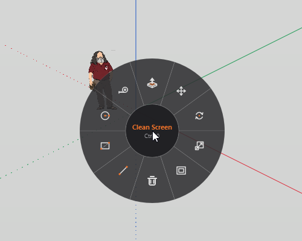
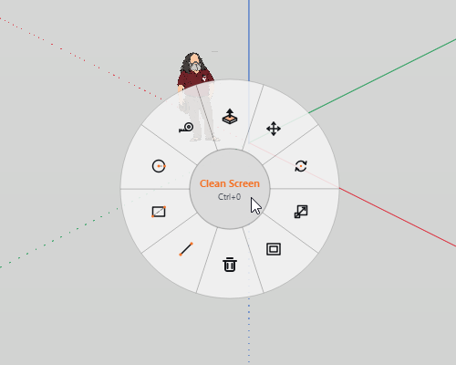

# V Menu for IngeTrazo

Radial (pie) menu extension for the [IngeTrazo](https://github.com/IngeTrazo/IngeTrazo) 3D CAD/BIM modeler.

Pressing **`V`** opens a 10-tool circular menu directly under the cursor.

  
  

## Usage

1. Press **`V`** anywhere in the viewport or window.
2. Hover over a tool and left-click to select it.
3. Left-click the **center hub** to toggle Clean Screen mode (`Ctrl+0`).
4. To cancel, press **`Esc`**, press **`V`** again, or right-click.

## Installation

1. Download the `.zip` archive from the [Releases](https://github.com/priit123/ingetrazo-v-menu/releases) page.
2. In IngeTrazo, go to: **Extensions ▸ Open plugins folder**
   - Alternatively navigate manually:
     - **Windows:** `%APPDATA%\ingetrazo\plugins\`
     - **Linux:** `~/.local/share/ingetrazo/plugins/`
     - **macOS:** `~/Library/Application Support/ingetrazo/plugins/`
3. Extract the zip into that folder (as a `v_menu` folder).
4. Restart IngeTrazo.

## Settings & Customization

You can adjust the size of the radial menu and customize each of the 10 tool slots directly from the settings dialog:

1. In IngeTrazo, go to: **Extensions ▸ V Menu Settings...**
2. **Menu Size:** Use the slider to scale the menu between **50% and 150%** (in 5% steps). Click **Reset to 100%** to restore the default size.
3. **Menu Slots:** Assign any of the 21 supported IngeTrazo tools to any slot (Slot 1 at 12:00 North, clockwise to Slot 10):
   - Push/Pull (`P`), Move (`M`), Rotate (`Q`), Scale (`S`), Offset (`F`)
   - Delete (`Del`), Eraser (`E`), Line (`L`), Rectangle (`R`), Circle (`C`)
   - Tape Measure (`T`), Dimension (`D`), Arc (`A`), Paint / Material (`B`)
   - 3-Point Arc (`J`), Center Arc (`Shift+O`), Protractor (`Shift+H`)
   - Text (`X`), Path (`Y`), Orbit (`O`), Pan (`H`)
4. Click **Reset Slots to Default** at any time to restore the original 10-tool layout.

## License

GPL-3.0-or-later
