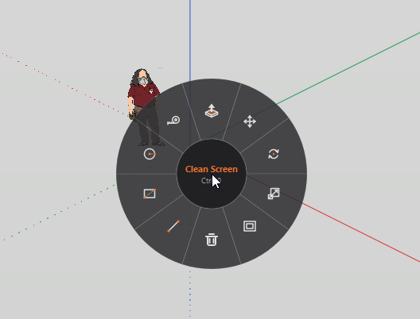
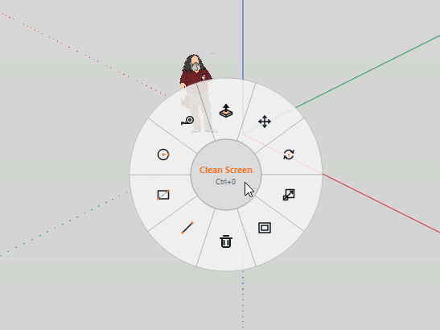

# V Menu for IngeTrazo

Radial (pie) menu extension for the [IngeTrazo](https://github.com/IngeTrazo/IngeTrazo) 3D CAD/BIM modeler.

Pressing **`V`** opens a 10-tool circular menu directly under the cursor.

  
  

## Usage

1. Press **`V`** anywhere in the viewport or window.
2. Hover over a tool and left-click to select it.
3. Left-click the **center hub** to toggle Clean Screen mode (`Ctrl+0`).
4. To cancel, press **`Esc`**, press **`V`** again, or right-click.

## Installation

1. Download the `.zip` archive from the [Releases](https://github.com/priit123/ingetrazo-v-menu/releases) page.
2. In IngeTrazo, go to: **Extensions ▸ Open plugins folder**
   - Alternatively navigate manually:
     - **Windows:** `%APPDATA%\ingetrazo\plugins\`
     - **Linux:** `~/.local/share/ingetrazo/plugins/`
     - **macOS:** `~/Library/Application Support/ingetrazo/plugins/`
3. Extract the zip into that folder (as a `v_menu` folder).
4. Restart IngeTrazo.

## Customization

The tool list can be customized by editing `PIE_ITEMS` in `__init__.py`.

## License

GPL-3.0-or-later
